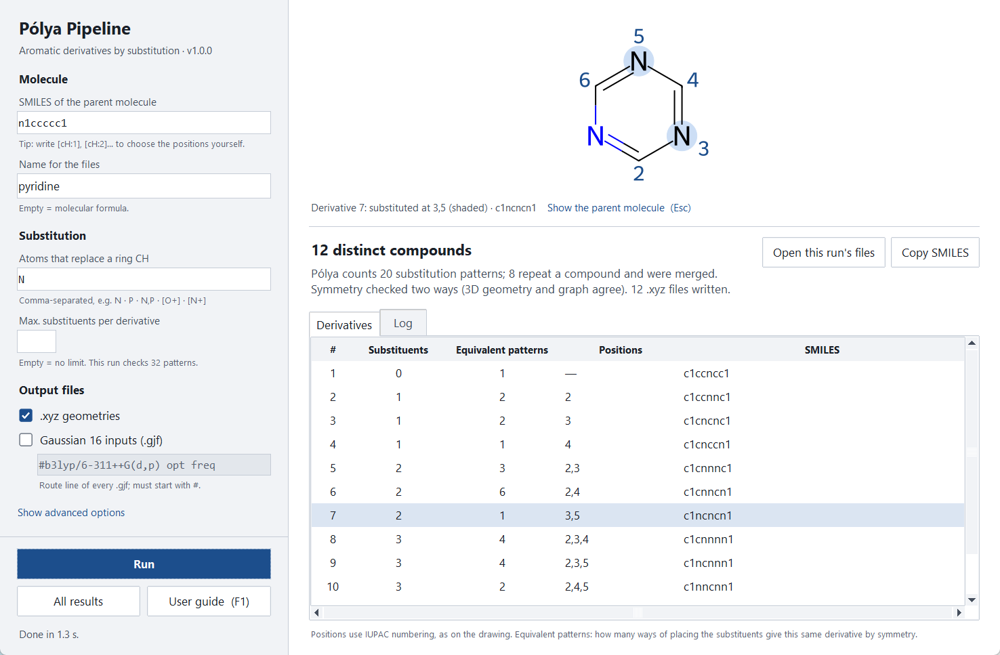

# Pólya Pipeline

**Count and generate every distinct derivative of an aromatic molecule — ready for DFT.**

Pólya Pipeline takes the SMILES of an aromatic parent molecule and the atoms that replace its
ring CH groups (N, P, [O+]…). It counts the distinct derivatives with Pólya's enumeration theorem,
lists one SMILES for each, numbers the positions with IUPAC locants and writes a 3D geometry
(`.xyz`) and a Gaussian 16 input (`.gjf`) for every derivative.



## Features

- **Counting you can check.** The symmetry group is obtained twice — from the 3D geometry and from
  the molecular graph — and Pólya's cycle index gives the number of derivatives for any number and
  kind of substituents.
- **Distinct compounds only.** When a substituent is the same element as a ring heteroatom
  (N on pyridine), patterns that give the same compound are merged and both numbers are reported.
- **IUPAC numbering.** Positions carry the IUPAC locants of the parent (toluene ortho = 2, 6;
  naphthalene α = 1, 4, 5, 8; biphenyl 2…6, 2′…6′). Ring systems outside the program's table are
  clearly marked as program numbering.
- **Files for calculations.** One `.xyz` geometry (ETKDG + MMFF/UFF) and, optionally, one
  Gaussian 16 input per derivative with your own route line; a CSV table of all results.
- **Window or terminal.** A graphical interface with live drawing, validation, a sortable table
  and an in-app user guide, and a command-line interface for scripts and batch work.

## Installation

1. Install **Python 3.8 or newer** from [python.org](https://www.python.org/downloads/)
   (on Windows, tick *Add python.exe to PATH*). Tested with Python 3.14.
2. Download this folder and open a terminal in it.
3. Install the dependencies (numpy, RDKit, Pillow):

   ```bash
   python -m pip install -r requirements.txt
   ```

   On Linux, Tkinter may need to be installed separately (e.g. `sudo apt install python3-tk`).

## Quick start

**Window (GUI).** Double-click `PolyaPipeline.bat` on Windows, or run:

```bash
python derivatives_gui.py
```

Enter a SMILES, the atoms that replace a ring CH, and press **Run** (or Enter). Click a row of the
results to draw that derivative; press **F1** for the user guide.

**Terminal.**

```bash
python derivatives.py --smiles "n1ccccc1" --subst N                  # pyridine + N
python derivatives.py --smiles "c1ccc2ccccc2c1" --subst N,P          # naphthalene + N and P
python derivatives.py --smiles "c1ccccc1" --subst N --gaussian \
                      --route "#b3lyp/6-311++G(d,p) opt freq"        # also Gaussian inputs
python derivatives.py --help                                         # all options
```

Example: pyridine with N gives 20 substitution patterns that are **12 distinct compounds**
(the diazines, triazines, tetrazines and pentazine):

```
     #  Subs     # N  Patterns  Positions     SMILES
     1     0       0         1  —             c1ccncc1
     2     1       1         2  N: 2          c1ccnnc1
     3     1       1         2  N: 3          c1cncnc1
     4     1       1         1  N: 4          c1cnccn1
     …
```

## Output

All files go to `generated_files/` inside the program folder:

| Path | Content |
|---|---|
| `tables/<name>_<substituents>.csv` | the results table (opens in Excel) |
| `xyz/<name>/<name>_<substituents>_001.xyz` | one 3D geometry per derivative |
| `gaussian/<name>/<name>_<substituents>_001.gjf` | one Gaussian 16 input per derivative (optional) |

The number in each file name is the `#` column of the table. See [`userguide.txt`](userguide.txt)
for every option, the numbering rules and troubleshooting.

## Validation

`tests/control_test.py` runs the program on 32 molecules — rings of 3 to 18 atoms,
heteroaromatics, substituted benzenes, fused polycyclics, charged rings and two-substituent runs —
and checks, for each one:

- Pólya's count against the enumeration;
- the derivatives against an independent brute-force count of distinct compounds;
- hand-calculated values (e.g. benzene 13, naphthalene 76, naphthalene with two substituents 1701);
- the IUPAC locants of the positions and of the monosubstituted derivatives;
- the drawing, the `.xyz` and the `.gjf` files.

```bash
python tests/control_test.py
```

The latest report is in [`tests/validation_report.txt`](tests/validation_report.txt) (32 / 32 pass).

## Limitations

- Substituents are single atoms that replace a ring CH (N, P, B, [O+], [N+]…). Atoms making only
  one bond (F, Cl, Br, I) cannot sit in a ring; a neutral O or S cannot replace a CH of a
  six-membered aromatic ring.
- By default only aromatic CH are substituted; other positions can be chosen with atom maps in the
  SMILES (`[cH:1]`).
- IUPAC numbering covers single rings, ring assemblies and the fused parents listed in the user
  guide; other fused systems are numbered 1, 2, 3… and labelled as such.
- The 3D symmetry check is designed for planar aromatic systems; for twisted or non-planar
  molecules it is reported as a note, and the count always uses the graph symmetry.
- The number of patterns grows quickly; very large runs can be limited with `--max-subst`.

## Citing

If you use Pólya Pipeline in your work, please cite it (see [`CITATION.cff`](CITATION.cff)):

> Tena Martínez, J. *Pólya Pipeline* (version 1.0.0), 2026.

## License

[MIT](LICENSE) — free to use, modify and share, keeping the copyright notice.

© 2026 Jorge Tena Martínez
